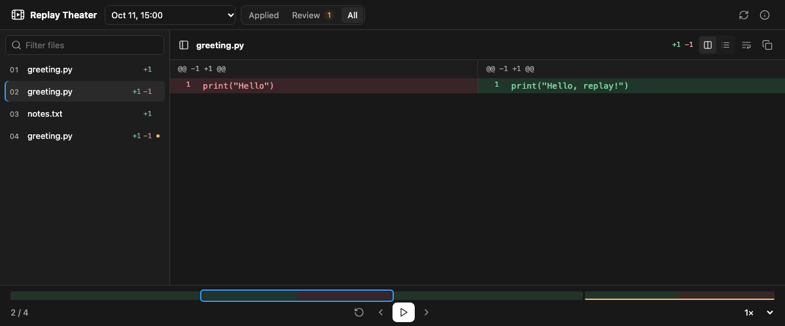

# Replay Theater for Codex

[English](#english) · [简体中文](#简体中文) · [Download ZIP / 下载 ZIP](https://github.com/FeidaWang/Reply-Theatre/releases/tag/v0.5.0)



## English

Replay Theater is a replay button for file edits Codex recorded. Say Codex changed three files and you want to see what happened. Open the replay, pick an edit, and see the lines that were added or removed. That before-and-after view is called a **diff**. You can read it in the chat or step through it in a panel beside the chat.

### Install

You need a Codex desktop app that supports local plugins and their panels, the `codex` command, and Python 3.9 or newer. In Terminal, run `codex --version` and `python3 --version` to check that both commands work. Replay Theater is free and uses the Python already on your computer.

Paste these two lines into Terminal and press Enter. The first tells Codex where to find the plugin. The second installs it.

```sh
codex plugin marketplace add FeidaWang/Reply-Theatre
codex plugin add replay-theater@reply-theatre
```

Reopen Codex Desktop, then open a local chat. This is a community plugin distributed on GitHub by Feida Wang. [Download the ZIP](https://github.com/FeidaWang/Reply-Theatre/releases/tag/v0.5.0) if you prefer to install from a file. [ZIP installation steps](#install-from-the-zip)

### Try your first replay

1. In the chat, type `$replay-theater:replay` and ask **“Open the interactive Replay Theater demo.”** The demo uses sample edits.
2. Click **Play** or pick a step on the timeline. Green shows lines that were added. Red shows lines that were removed. **Applied** shows completed edits and **Review** shows edits that need a closer look.
3. To see your own edits, go to the local chat where Codex changed a file. Ask **“Show me the recorded file edits in this chat.”** Then ask **“Show me the diff for step 2”** if the list has a second step, or ask to open the panel.

Replay Theater reads the edit history that Codex recorded. Edits from shell commands, formatters, other tools, or subagents may be missing. The replay shows recorded changes, and you can copy a diff to inspect it elsewhere. The plugin reads your project history without editing or restoring your files.

If the panel does not open, check that the plugin is enabled and the chat is local. Try asking for the demo as a numbered list. The chat summary can work on hosts that support the local plugin tools but lack the panel.

## 简体中文

Replay Theater 就像一个「回放」按钮。比如 Codex 刚改了三个文件，你想看看它具体改了哪里。打开回放，点选一步，就能看到新增和删掉的代码行。这种改动前后的对照叫 **diff**。你可以在聊天里查看，也可以打开聊天旁边的面板，一步步看。

### 安装

你需要支持本地插件及其面板的 Codex 桌面版、`codex` 命令和 Python 3.9 或更新版本。在终端运行 `codex --version` 和 `python3 --version`，确认两个命令都可用。Replay Theater 免费，使用电脑上已有的 Python。

把下面两行贴到终端，按回车。第一行告诉 Codex 去哪里找插件，第二行安装插件。

```sh
codex plugin marketplace add FeidaWang/Reply-Theatre
codex plugin add replay-theater@reply-theatre
```

重新打开 Codex 桌面版，再打开一个本地聊天。这是 Feida Wang 在 GitHub 发布的社区插件。也可以先下载 ZIP，再按文末的步骤从文件安装。[下载 ZIP](https://github.com/FeidaWang/Reply-Theatre/releases/tag/v0.5.0) · [从 ZIP 安装](#install-from-the-zip)

### 试一次回放

1. 在聊天里输入 `$replay-theater:replay`，然后说 **「打开 Replay Theater 的互动演示」**。演示用的是示例改动。
2. 点击 **Play**（播放），或点时间轴上的某一步。绿色是新增的行，红色是删掉的行。**Applied** 是已完成的改动，**Review** 是需要进一步核对的改动。
3. 想看自己的改动，就打开 Codex 改过文件的那个本地聊天，说 **「列出这个聊天里记录到的文件改动」**。如果列表有第二步，可以接着说 **「显示第 2 步的改动对比」**，也可以请 Codex 打开回放面板。

回放取自 Codex 保存的改动记录。终端命令、格式化工具、其他工具或子代理做的改动有时不会被记录下来。你可以复制 diff 到别处查看。插件只读取改动记录，不会替你修改或恢复项目文件。

如果打不开面板，先确认插件已启用，当前打开的是本地聊天。也可以请 Codex 把演示改动列成编号清单。能运行本地插件工具的客户端，即使没有面板，也可以在聊天里显示清单。

### Install from the ZIP

Download `replay-theater-openai-desktop-mcp-0.5.0.zip` from the release. Open Terminal in the folder where you downloaded it and run the commands below. Keep the extracted folder so Codex can find it again.

从发布页下载 `replay-theater-openai-desktop-mcp-0.5.0.zip`。在下载目录打开终端，运行下面的命令。请保留解压后的文件夹，方便 Codex 以后找到它。

```sh
replay_install_dir="$(mktemp -d "$PWD/replay-theater-install.XXXXXX")"
unzip replay-theater-openai-desktop-mcp-0.5.0.zip -d "$replay_install_dir"
mkdir -p "$replay_install_dir/.agents/plugins"
cat > "$replay_install_dir/.agents/plugins/marketplace.json" <<'JSON'
{
  "name": "reply-theatre-zip",
  "plugins": [
    {
      "name": "replay-theater",
      "source": {"source": "local", "path": "./replay-theater"},
      "policy": {"installation": "AVAILABLE", "authentication": "ON_INSTALL"},
      "category": "Productivity"
    }
  ]
}
JSON
codex plugin marketplace add "$replay_install_dir"
codex plugin add replay-theater@reply-theatre-zip
```

Use one installation method. Reopen Codex Desktop after installing. 两种安装方式选一种即可，安装后重新打开 Codex 桌面版。

[Help / 帮助](SUPPORT.md) · [Privacy / 隐私](PRIVACY.md) · [Terms / 使用条款](TERMS.md) · [Local commands / 本地命令](skills/replay/references/local-use.md) · [MIT License](LICENSE)
